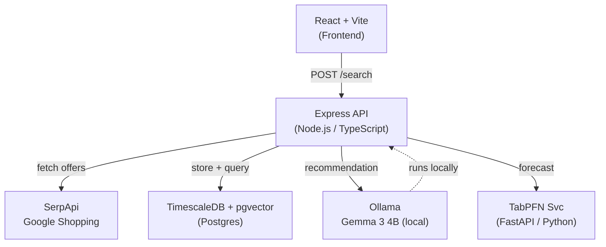

# ShoeScout 👟

> Built for **Sanskar** — finds the best running-shoe deal across platforms,
> forecasts whether to buy now or wait, and explains it in plain English using
> a **local Gemma model**. Sanskar's preferences never leave the machine.

*A submission for the [Hacktoberfest Weekend Challenge: Build for a Friend](https://dev.to/challenges/hacktoberfest-weekend-2026-10-01).*

---

## Architecture



---

## Who Is Sanskar?

Sanskar runs 5 km three times a week on roads. He's been trying to find a
good pair of neutral running shoes under ₹10,000 in UK size 9. The problem:
the same shoe can be ₹9,499 on Amazon and ₹7,999 on Myntra on the same day,
and he never knows if the price is good or just regular. ShoeScout fixes that.

---

## Quick Start (local)

### Prerequisites

| Tool | Version |
|---|---|
| Docker Desktop | 4+ |
| Node.js | 20+ |
| pnpm | 9+ |
| Ollama | latest |

### 1. Clone & configure

```bash
git clone https://github.com/YOUR_USERNAME/shoescout.git
cd shoescout
cp .env.example .env
# Edit .env — fill in SERPAPI_KEY at minimum
```

### 2. Start backing services

```bash
docker compose up -d
# Postgres (TimescaleDB + pgvector) → localhost:5432
# Ollama                            → localhost:11434
```

### 3. Pull Gemma and the embedding model

```bash
ollama pull gemma3:4b
ollama pull nomic-embed-text
```

### 4. Run migrations

```bash
# Applies 001_initial_schema.sql and 002_seed_synthetic_history.sql
psql $DATABASE_URL -f db/migrations/001_initial_schema.sql
psql $DATABASE_URL -f db/migrations/002_seed_synthetic_history.sql
```

### 5. Install dependencies & start the API

```bash
pnpm install
pnpm dev:api
# → http://localhost:3000/health
```

### 6. (Optional) Start TabPFN service

```bash
cd apps/tabpfn-svc
pip install -r requirements.txt
uvicorn main:app --port 8001
```

---

## Environment Variables

| Variable | Required | Default | Description |
|---|---|---|---|
| `DATABASE_URL` | ✅ | — | Postgres connection string |
| `SERPAPI_KEY` | ✅ | — | SerpApi key (Google Shopping) |
| `SERPAPI_FIXTURE_MODE` | | `false` | `true` = use saved JSON, no quota burned |
| `OLLAMA_BASE_URL` | | `http://localhost:11434` | Ollama server |
| `OLLAMA_MODEL` | | `gemma3:4b` | **Swap model with this one env var** |
| `OLLAMA_EMBED_MODEL` | | `nomic-embed-text` | Embedding model for pgvector |
| `TABPFN_SERVICE_URL` | | `http://localhost:8001` | TabPFN micro-service |
| `RATE_LIMIT_RPM` | | `30` | Requests per minute per IP |

---

## Running Tests

```bash
pnpm test              # unit tests (Vitest)
pnpm test -- --coverage
```

---

## Data Source Notes

- **SerpApi** (Google Shopping): live prices fetched on demand, cached 10 min.
- **Synthetic price history** (`is_seeded = TRUE`): 45 days of generated data
  for the demo. It is clearly labelled in the database, API responses, and UI.
  It is **never presented as real pricing data** anywhere in the product.

---

## Limitations

- Price data depends on SerpApi's availability and Google Shopping coverage.
- Size availability from SerpApi is inconsistent — marked `unknown` when absent.
- TabPFN forecasts are illustrative with limited history; confidence shown explicitly.
- Gemma runs locally; on low-RAM machines use `gemma3:4b` (needs ~4 GB).

---

## What Was Built During the Challenge Window

The challenge window opened **2026-10-01**. All commits tagged `[challenge]`
in the git log were made within the window. Any post-deadline polish is noted
in commit messages.

---

## License

MIT
